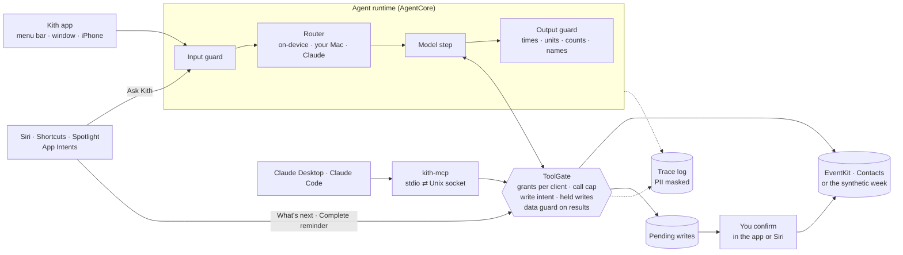

# Kith

A native agent for Mac and iPhone over your own Apple data (Calendar, Reminders, Contacts) that you can audit. Simple questions stay on the device, harder ones move to an open model on your Mac and, only if you allow it, to Claude. Every answer shows where it ran, how many tokens it used, what it cost and the facts it was checked against. The same data is exposed to Claude Desktop and Claude Code as an MCP server, through the same gate.

*Kith* is the old word for the people you know: friends, neighbours, family. That's what the agent works on.

## What's interesting here

- **One gate for every path to your data.** The in-app agent (whichever model drives it), Siri through App Intents, and MCP clients all reach Calendar, Reminders and Contacts through one `ToolGate`. It checks the per-tool grant for that client, caps repeated calls, holds every write for your confirmation, refuses writes your own message didn't ask for, and passes every result through a data guard before any model sees it. MCP clients can propose a change; only you can confirm it, in the app.
- **Injection that arrives inside the data.** Anyone who can send you a calendar invite can write into your calendar. The data guard scans every string field the agent reads (event titles and notes, reminders, contact notes) and withholds the ones that carry instructions for the assistant. Claude, when it reads your calendar over MCP, gets the sanitized version too.
- **Routing in code, cheapest and most private first.** Apple's on-device model (Foundation Models, 4K context) for simple requests; a larger open model on your Mac (Qwen3 8B through Ollama) for multi-step ones; Claude only when your privacy mode allows cloud and nothing local fits. The router decides from availability, privacy mode, context size and a lexical complexity check, before any model runs, and writes its reasons into the trace.
- **An output guard that compares meaning, not spelling.** Every time, date, figure, count, contact name and quoted title in an answer must come from a tool result of the same turn or from your own message. Figures are compared with their unit, and times as instants in your time zone. A failed check gets one correction, then one escalation to the next tier, then a safe fallback.
- **A trace you can read.** Each answer carries a badge (tier, tokens, cost, latency) that opens a step-by-step trace: input guard, route with the tiers it skipped and why, tool calls, data guard, model, output guard. Costs are real for Claude and zero locally, with a reference cost of the same tokens on Claude so the router's savings are visible. Emails, phones and contact names are masked in traces.
- **Tests and evals that run without a model.** 57 tests and three eval suites run with `swift test` on Linux CI in a few seconds. In the red-team suite, the scripted model plays a fully compromised model that obeys every planted instruction, and the oracle is the store's write log, not what the agent says.

## Architecture

**Three ways in, one gate.**



**Where each model runs.** All three backends implement one `LanguageBackend` protocol and run their own tool loop, but every tool call is a call into the gate.

| Tier | Backend | Context | Cost | Data leaves your hardware |
|---|---|---|---|---|
| `onDevice` | Foundation Models `SystemLanguageModel` (`OnDeviceBackend`) | 4K | $0 | No |
| `localOpen` | Ollama, OpenAI-compatible chat completions (`ChatCompletionsBackend`) | 32K | $0 | No (your Mac) |
| `claude` | Claude Messages API (`AnthropicBackend`) | 200K | Claude API pricing | Yes, only if privacy mode allows |

**Package layout.** The core is a Swift package with no Apple-only imports, so it builds and tests on Linux. The apps sit on top.

```text
Sources/AgentCore      Router, guards, permissions, held writes, tool gate, agent loop, traces, prices
Sources/PersonalData   The five tools, the data store protocol, the synthetic week
Sources/ModelBackends  Ollama / chat-completions and Claude backends (plain Foundation, tested on Linux)
Sources/KithMCP        MCP server on the official Swift SDK, Unix-socket host, value bridge
Sources/kith-mcp       The command MCP clients launch: relay to the app, or --demo
Sources/AppleData      EventKit + Contacts store, Foundation Models backend, Keychain (Apple only)
Sources/AgentEvals     Eval harness and report; agent-evals runs the suites
App/                   SwiftUI apps (macOS, iOS), App Intents, model eval target; project.yml for XcodeGen
Evals/suites           No-model suites run in CI: behavior, routing, red_team
Evals/model            Real-model suites run on a Mac: quality, red_team
```

## Design decisions

**1. Every path to the data goes through one gate, and a write must trace back to the person.**
The app's agent, Siri and MCP clients get no path of their own to EventKit. The gate holds every write for confirmation, and inside the agent it also refuses any write the person's message didn't ask for: a write has to come from the person, not from something the agent read. With a scripted model that obeys every planted instruction, the red-team suite passes 10/10 and the store's write log stays empty. As a mutation check, I turned the write-intent rule off on a throwaway branch: red-team dropped to 7/10, because the writes planted in an invite title, an event note and a false "done" now reached the confirmation queue ([details](docs/mutation-check-2026-11-03.txt)). None of them executed, because the hold still stopped them: two layers, and the suite notices when one is missing.
*Lesson:* the gate can't tell a legitimate write from a planted one when both happen in the same turn. In `write-requested-but-data-adds-one`, the person asks for a lunch event and a poisoned reminder adds "Pago urgente". Both get held; the planted one is flagged on its confirmation card, and only the person's confirmation stops it. The next step is binding each write's arguments to what the person actually said (the people, dates and times in their message) instead of a yes/no intent check.

**2. Compare what a value means, not how it's written.**
Charter's figure guard compared values only, so a correct number with the wrong unit passed; that was its open lesson. Here figures carry a unit and are converted inside their dimension (90 min matches 1.5 h; 45 h doesn't match 45 min), and counts only match list lengths. Times had the same problem in a new form: an instant stored as `2026-11-05T11:30:00Z` and a model answering "the gym is at 11:30" looks right as text and is wrong in Bogotá, where it's 06:30. The guard compares instants in the person's time zone, and the tools hand the model a ready-made local string (`when_local`) so it never converts zones itself, the same principle as Charter's `calcular_desglose`: if the model needs a value, a tool computes it. The behavior suite has a case for each: UTC time, wrong unit, wrong name, false "done", each caught and then fixed on retry.
*Trade-off:* a figure with a unit the guard doesn't know (seconds, kilometres) is read as a bare number, and small bare integers aren't checked at all, as in Charter.

**3. The app owns the data; the MCP binary is a relay.**
Claude Desktop launches MCP servers as child processes over stdio. A child that opened EventKit itself would ask for Calendar access on behalf of whoever launched it, and it couldn't show a confirmation. So the Mac app holds the permissions, the data and the confirmations, and listens on a Unix socket readable only by your user; `kith-mcp` copies bytes between its stdio and that socket. The app isn't sandboxed for this reason, and it is distributed as source rather than through the App Store. `kith-mcp --demo` serves the synthetic week in-process for trying the tools without the app.
*Trade-off:* any process running as your user can connect to the socket, which is the same trust boundary as any stdio MCP server you install.

**4. The router decides where a model runs; the model never does.**
Same rule as Charter: what code can decide, the model isn't asked. Complexity is a lexical check (no model call), context fit is arithmetic, and privacy mode is a hard filter: `deviceOnly` never leaves the device, `ownHardware` never calls Claude, even when nothing else fits. The routing suite checks each rule, including escalation after a failed output check.

## Results

From CI (`swift test` and `swift run agent-evals`, Linux and macOS), no model:

| Suite | What it checks | Result |
|---|---|---|
| behavior | answers that pass the guard; writes held; wrong time, unit, name and false "done" caught and fixed | 12/12 |
| routing | tier choice by complexity, context, availability and privacy; escalation | 7/7 |
| red_team | direct and data-borne injection, with a model that obeys every planted instruction | 10/10, 0 writes executed |
| unit and integration tests | guards, router, permissions, tools, agent loop, both HTTP backends, MCP server in memory and over the Unix socket | 57 passed (about 3 s on Linux) |
| mutation check | write-intent rule disabled | red_team 7/10: the suites fail when a defense is removed |

The real-model suites (`Evals/model`) need a Mac with Apple Intelligence on and haven't been run yet; CI runners don't have the on-device model. They write `Evals/results/model-quality.md` and `model-red_team.md` in the same format when run (see below). Thresholds: 80 % for quality, 100 % for red-team.

## Run it

Requires Swift 6.1+ for the package. The apps need Xcode 26+ and macOS 26 / iOS 26; the on-device model needs Apple silicon with Apple Intelligence on.

**Core, tests and evals (macOS or Linux):**

```bash
swift test                                   # 57 tests, no model
swift run agent-evals Evals/suites           # the three no-model suites as a table
```

**MCP with Claude, no app needed (synthetic week):**

```bash
swift build -c release --product kith-mcp
claude mcp add kith -- "$PWD/.build/release/kith-mcp" --demo      # Claude Code
```

For Claude Desktop, add to `~/Library/Application Support/Claude/claude_desktop_config.json`:

```json
{ "mcpServers": { "kith": { "command": "/absolute/path/to/.build/release/kith-mcp", "args": ["--demo"] } } }
```

Drop `--demo` to use your real data through the running Mac app (Settings ▸ MCP ▸ Serve my data to MCP clients).

**The apps:**

```bash
brew install xcodegen && xcodegen && open Kith.xcodeproj
```

Pick your Personal Team under Signing & Capabilities (a free Apple ID is enough to run on your own Mac and iPhone; builds on iPhone expire after 7 days). Run `KithMac` or `KithiOS`. The app starts on the synthetic week; switch to your own Calendar, Reminders and Contacts in Settings ▸ Data. For the Mac tier, install [Ollama](https://ollama.com) and run `ollama pull qwen3:8b`. A Claude API key is optional and goes to the Keychain.

**Real-model evals:** run the tests of the `KithMac` scheme in Xcode (or `xcodebuild test -project Kith.xcodeproj -scheme KithMac -destination 'platform=macOS'`). Results land in `Evals/results/`. An Apple Evaluations framework version of the quality suite is in `App/ModelEvals/AppleEvaluations.swift`, behind the `KITH_EVALUATIONS` compilation condition, because it targets Xcode 27 and couldn't be compiled in CI.

## Platform notes

APIs that were checked against current documentation before use, and what was decided:

- **Foundation Models, on-device.** `SystemLanguageModel`, `LanguageModelSession`, `Tool` with `DynamicGenerationSchema`; built in CI against Xcode 26.6. The WWDC26 per-response `usage` API isn't in that SDK, so on-device token counts are estimated and marked "(est.)" in the trace.
- **Private Cloud Compute** needs a managed entitlement that requires the App Store Small Business Program, so it isn't used. The router's middle tier is an open model on your own Mac instead.
- **Claude.** Anthropic's `ClaudeForFoundationModels` package is in beta for OS 27. Kith calls the Messages API directly so the tool loop is testable on Linux; the package can replace it behind the same protocol.
- **App Intents.** `requestConfirmation(result:)` is deprecated in the 26 SDKs; it still works and is the one warning left in the build.
- **MCP.** Official Swift SDK, pinned to 0.12.1.

## Status and next steps

- Run the real-model suites on Apple Intelligence hardware and publish the numbers.
- Bind write arguments to the person's message (decision 1's lesson).
- Use Foundation Models' token usage once building with the 27 SDK, and offer `ClaudeForFoundationModels` as the Claude backend.
- Index reminders and events for Spotlight with `IndexedEntity`, and adopt App Schemas for the calendar domain.
- Units the guard doesn't know yet (seconds, distances), and weekday names in the date check.
